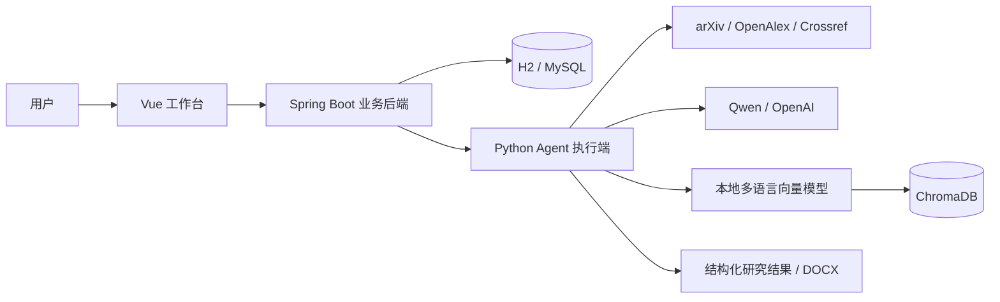

# Paper-Helper

**面向论文阅读与研究学习的 Agent 工作台。** 将论文检索、收藏管理、正文检索增强、研究分析和学习报告生成串联起来，帮助用户从找到论文走向理解论文。

项目采用 **Vue 3 + Spring Boot + Python Agent** 架构：Vue 提供交互界面，Java 管理账号、资料和任务，Python 执行论文分析与 RAG。适合结合实际业务学习 Java 后端、前后端协作和 Agent 开发。

## 核心功能

| 功能 | 说明 |
| --- | --- |
| 论文检索 | 接入 arXiv、OpenAlex、Crossref，支持多关键词、精准/模糊匹配、相关性/时间/引用排序和分页；具体能力受来源支持限制 |
| 智能搜索 Agent | 使用个人默认模型理解问题、规划多来源查询、审查标题与摘要证据并按需补搜，展示相关性、实体依据和检索缺口 |
| 引用追踪 Agent | 从 1～5 篇收藏论文双向追踪一层参考文献与后续引用，展示相关性依据和发现路径，支持保存候选 |
| 收藏与笔记 | 收藏夹及论文资料增删改查，支持收藏夹整体笔记与单篇论文笔记 |
| Agent 研究 | 按主题或指定收藏论文发起研究，生成逐篇分析、跨论文总结和研究构思 |
| PDF 学习报告 | 提前准备开放 PDF 或上传已有 PDF，正文就绪后生成带证据的学习报告；选定论文自动填写分析主题 |
| Word 导出 | 下载 DOCX 学习报告，正文使用简短编号引用，保留证据页码和来源 |
| Chroma RAG | 本地多语言模型生成向量，ChromaDB 持久化论文片段，按账号、论文和正文版本限定检索 |
| 任务管理 | 进行中、未完成、历史研究三个列表，支持主题搜索、每页 10 条分页、阶段记录和失败任务重试 |
| 个人模型设置 | 按账号配置 Qwen / OpenAI 密钥与默认模型，支持连接测试和删除密钥 |
| Redis 加速与限流 | 可选启用论文搜索缓存和按用户的搜索/研究任务限流，Redis 故障时回到原业务链路 |
| 离线演示 | 使用内置资料体验研究链路，无需大模型 API Key；真实论文搜索仍需网络 |

## 系统架构



- **Vue**：登录、论文搜索、收藏夹、模型设置、研究任务和报告展示；浏览器业务请求统一访问 Java。
- **Java**：单模块三层架构，使用 `Controller → Service 接口 → ServiceImpl → Mapper`，负责权限、参数校验、事务、持久化及调用 Python 内部接口。
- **Python**：负责论文检索、PDF 解析、证据索引、上下文构建、Agent 编排及报告生成。

任务使用幂等标识和持久化记录；重试创建新的任务记录，原记录保留。内部服务通过共享 Token 验证身份。个人模型密钥加密保存，接口读取只返回脱敏提示。

## 技术栈

| 层次 | 技术 |
| --- | --- |
| 前端 | Vue 3、TypeScript、Vite、Vue Router、Pinia |
| Java 后端 | Java 21 编译目标、Spring Boot 3、Spring Security、MyBatis、Flyway |
| 业务数据库 | 本地默认 H2；提供 MySQL 配置 |
| 缓存与限流 | Redis、Spring Data Redis、Lua 原子计数；MySQL 模式支持 Redis Session |
| Agent 执行端 | Python 3.11+、FastAPI、Pydantic、OpenAI Agents SDK |
| RAG | ChromaDB、ONNX Runtime、本地 multilingual-e5-small 多语言向量模型 |
| 文档处理 | pypdf、python-docx |
| 测试 | JUnit、Spring Boot Test、Vitest、Playwright、Python unittest |

正式研究编排使用项目内的 `ResearchWorkflow`。仓库还保留独立的 LangGraph 离线学习入口、MCP 工具入口及早期 Python/React 网页实现。

## 快速开始

以下以 Windows PowerShell 为例。准备 Python 3.11+、JDK 21～25、Node.js 22.18+，克隆仓库后进入项目目录：

```powershell
git clone https://github.com/Zaicod/Paper-Helper.git
cd Paper-Helper
py -m venv .venv
.\.venv\Scripts\python.exe -m pip install --upgrade pip
.\.venv\Scripts\python.exe -m pip install -e '.[web,rag]'
```

完整工作台需要分别启动 Python、Java 和 Vue。两个后端中的 `PAPERFLOW_SERVICE_TOKEN` 必须设置为**相同的、自行生成的至少 32 字符随机字符串**；它用于内部服务认证，与大模型 API Key 不同。

**终端一：启动 Python**（项目根目录）

```powershell
$env:PAPERFLOW_SERVICE_TOKEN = '替换为自己生成的至少32字符随机字符串'
.\.venv\Scripts\python.exe -B -m paper_agent.interfaces.worker --host 127.0.0.1 --port 8001
```

**终端二：启动 Java**（项目根目录）

```powershell
$env:PAPERFLOW_SERVICE_TOKEN = '替换为与Python完全相同的随机字符串'
$env:PAPERFLOW_WORKER_URL = 'http://127.0.0.1:8001'
cd java-backend
.\run-local.cmd
```

**终端三：启动 Vue**（项目根目录）

```powershell
cd frontend-vue
npm ci
npm run dev
```

打开 <http://127.0.0.1:5173> 并注册账号。本地默认使用 H2 与 SQLite，无需先安装 MySQL 或 Redis。

### 使用真实模型与 RAG

1. 在“个人设置”填写 Qwen 或 OpenAI API Key，选择模型，保存默认配置，并进行连接测试。也可按 `.env.example` 配置服务端环境变量。
2. 在项目根目录执行以下命令准备本地向量模型；首次下载需要网络，无需 Embedding API Key。

   ```powershell
   .\.venv\Scripts\python.exe scripts\prepare_embeddings.py
   ```

3. 检索论文并加入收藏夹，选中单篇或多篇后创建研究或学习报告任务。
4. 在“研究任务”查看阶段记录；完成后进入“历史研究”阅读和下载报告。

学习报告要求准备就绪的 PDF 正文及有效的大模型凭证。可在收藏夹准备正文或上传已有 PDF；修复资料后可从失败任务重新创建，原历史保留。参见[使用方法与 Java/Agent 协作讲解](docs/paper-evidence-learning.md)。开放文献源受网络、额度及各自检索能力限制；引用数属于对应来源的统计口径。

## 项目目录

```text
frontend-vue/             Vue 工作台
java-backend/             Java 业务服务、MyBatis、数据库迁移
paper_agent/
  agents/                Agent 角色与模型适配
  workflows/             研究流程编排
  services/              应用服务
  tools/                 论文检索、RAG、上下文与证据处理
  interfaces/            Python 执行端、DOCX、CLI、MCP 等入口
tests/                   Python 测试
scripts/                 模型准备与集成验证脚本
docs/                    架构、配置、功能与学习文档
```

## 测试与构建

```powershell
# Python（项目根目录）
.\.venv\Scripts\python.exe -m unittest discover -s tests

# Java（java-backend 目录，需要 JDK 21+）
.\mvnw.cmd test

# Vue（frontend-vue 目录）
npm test
npm run build
```

测试使用离线替身及本地测试数据库验证功能。真实模型效果、外部论文站点可用性和生产数据库需要在对应环境中验证。

## 进一步了解

- [Java 启动与配置](java-backend/README.md) · [Vue 启动说明](frontend-vue/README.md)
- [Java 三层架构](docs/java-architecture.md) · [Vue 接入说明](docs/vue-learning.md)
- [论文检索与收藏管理](docs/paper-search-learning.md) · [学习报告](docs/study-report-learning.md)
- [Chroma RAG](docs/chroma-rag-learning.md) · [个人模型设置](docs/model-settings-learning.md)
- [研究历史与分页](docs/research-history-learning.md)
- [任务调度可靠性与 Java 并发学习](docs/task-scheduling-learning.md)
- [智能搜索 Agent 与相关性审查](docs/intelligent-search-learning.md)
- [引用追踪 Agent 与 Java/Python 协作](docs/citation-tracking-learning.md)
- [Redis 缓存、限流与启动配置](docs/redis-learning.md)

项目以学习与本地运行场景为主。生成的研究分析和学习体会应结合原论文核对；API Key、内部 Token、本地数据库及生成报告不应提交到仓库。
