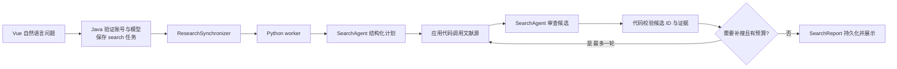

# 智能搜索：先分析问题，再检索和审查

## 为什么原搜索不够

普通搜索负责把关键词传给文献源，返回它们给出的结果。它不会主动理解数据集、转换中文研究方向，或判断已有结果是否偏题。自动来源回退也不等于多个来源的联合搜索。

新增的智能搜索把这些步骤拆开：模型制定计划，程序调用真实来源，再让模型审查候选；如果仍有缺口，可在预算内再搜一轮。论文元数据来自真实适配器，模型只能使用候选 ID 和摘录证据，不能编造论文或链接。

## 如何使用

1. 在“个人设置”保存模型 API Key，并设置个人默认模型。普通关键词搜索仍不需要大模型 Key；智能搜索会调用这个模型。
2. 在搜索页的智能搜索区域输入自然语言问题，例如：`多模态情绪识别 seediv seedvii`，然后提交。
3. 页面转到持久化任务详情，依次显示问题理解、来源检索、候选审查及可选补搜的进展。可以离开页面，再从任务列表打开。
4. 完成后先看问题分析和实体关系，再看实际检索记录、限制与缺口；不要只看返回数量。
5. 阅读每篇结果的筛选理由及标题/摘要证据，核对模态与数据集，再加入自己的收藏夹。需要确认实验设置时仍应读原文。

本例默认将 SEED-IV 与 SEED-VII 理解为“满足任一数据集”，分别搜索后合并，而不是要求每篇论文同时使用二者。若要求两者共同满足，应明确写“同时在 SEED-IV 和 SEED-VII 上评估”。

SEED-IV、SEED-VII 的正式名称及 EEG/眼动背景已参考 [BCMI 项目主页](https://bcmi.sjtu.edu.cn/home/seed/)、[SEED-IV](https://bcmi.sjtu.edu.cn/home/seed/seed-iv.html)、[SEED-VII](https://bcmi.sjtu.edu.cn/home/seed/seed-vii.html) 核对。这些是验收样例的背景依据，生产搜索不把该领域的论文列表硬编码成结果。

## 先按这条调用链读代码



Python 中：

- `core/search_agent.py`：结构化输入输出，包括实体、查询、候选、审查结果、来源记录和最终报告。长度与条数上限集中定义在契约中。
- `agents/search.py`：搜索规划员与检索审查员。规划员只生成计划；审查员只能引用提供的候选。关闭 SDK tracing，避免把私人研究资料导出到额外追踪服务。
- `services/intelligent_search.py`：受控执行循环，调用真实适配器、去重、计算预算、检查证据和实体匹配。这里决定是否继续，不把停止条件交给无限对话。
- `interfaces/worker.py`：接受 `task_type=search`，使用任务级个人凭证，生成并验证 `report_type=search_report`，保存结果后关闭客户端、清除运行时凭证。

Java 继续沿用 Controller → Service → Mapper 分层。任务提交保存不含密钥的快照，派发时才附加当前凭证。搜索任务和失败重试受每账号最多两个活动智能搜索任务的限制，现有生成请求限流也继续生效。相同幂等请求先返回原任务，不重复创建或消耗配额。

Vue 的 `SearchReportView` 独立渲染智能搜索结果，避免把它当成已经完成全文分析的研究报告。普通搜索的关键词、分页和收藏操作保持独立。

## 模型和程序各自负责什么

| 工作 | 谁负责 | 为什么 |
| --- | --- | --- |
| 研究方向改写、数据集别名建议 | 规划模型 | 需要语义理解；别名仍可能有误，应检查计划 |
| 参数编译、文献 API、来源超时 | 现有检索适配器 | 固定来源与语法，不让模型直接生成请求地址 |
| 请求上限、轮数、停止、去重 | 应用代码 | 能确定性地约束执行成本 |
| 相关性判断、补搜建议 | 审查模型 | 理解候选摘要与用户意图之间的关系 |
| 候选 ID、证据片段和实体校验 | 应用代码 | 拒绝模型新增候选及不存在的摘录 |
| 用户隔离、密钥、任务历史 | Java 与 worker | 复用现有身份与持久化边界 |

## 结果标签怎么读

- **相关**：模型认为对题，而且摘录、实体等校验条件满足；仍是元数据层面的判断。
- **待核实**：摘要缺失、证据不足、模型标注无法通过校验，或者尚未完成足够审查。
- **背景参考**：与主题有关系，但不直接满足目标；例如用户要求多模态，而候选仅支持单模态判断。

代码验证 evidence 确实来自对应标题或摘要，matched_entities 有相应别名依据；SEED-IV 不会因为简单子串匹配而与 SEED-IVI 混淆。模型给出的无效候选 ID 会被丢弃，无依据的摘录会被移除并降低确定性。

不过，“摘录存在”不能单独证明语义判断正确。文章可能只是引用数据集，或把视频作为刺激材料而非输入模态，因此界面明确提示还需全文核实。搜索不会据此宣称实际实验使用、最优性能或完整覆盖该领域。

## 预算、去重和故障

最多两轮、六次来源请求、三次模型调用；最多保留六十篇候选，最终展示一至二十篇或明确的空结果。默认最多四个首轮查询，再允许两个补搜查询。指定实体不能在补搜时静默移除，重复查询也不会再次执行。

程序按可识别的 DOI 页面、arXiv 标识及规范化页面 URL 合并命中，保留不同来源和查询的记录。元数据不足时宁可保留两个候选，也不只凭标题相似强行合并。

执行端的总期限为 120 秒，覆盖计划、检索和审查。排队和 Java 后续同步另计；页面不会承诺一定在两分钟内得到结果。arXiv 原有请求间隔和来源超时继续生效。

来源部分失败时可以保存其他来源的结果，并显示覆盖受限。所有来源均失败与来源正常返回空集合是不同情况，不能把网络故障解释成“没有相关论文”。失败或中断的搜索任务可在任务详情重试，会创建新记录并使用当前默认模型。

## 验证方法

`tests/test_intelligent_search.py` 使用明确的固定规划/审查替身和受控文献源，验证 OR 关系、多来源、证据校验、实体约束、缺口、去重、补搜和超时。它不代表真实大模型一定会制定同样的优质计划。

`tests/test_intelligent_search_worker.py` 通过真实本地 worker HTTP 接口与临时 SQLite，验证任务执行、持久化、重放和凭证不落库。Java 的测试覆盖账号隔离、幂等与并发配额；Vue 测试覆盖入口、报告类型、收藏及错误恢复。

```powershell
# 项目根目录
.\.venv\Scripts\python.exe -B -m unittest discover -s tests -p 'test_intelligent_search*.py'
.\.venv\Scripts\python.exe -B -m unittest discover -s tests
```

真实模型效果与外部来源实时可用性需要独立验证，不能用受控测试替代。本轮不会自动读取真实个人密钥进行付费模型验收。

2026-10-24 验证记录：Python 全量 157 项通过；Java 117 项中 111 项通过、6 项专用 Redis 环境测试跳过，打包成功；Vue 83 项通过，TypeScript 与生产构建成功。真实 Vue 的 Chrome 浏览器流程通过，桌面与 390px 手机截图检查完成。最终打包 Java → 真实 Python worker/账本/搜索循环 → 任务结果 → 收藏数据库联调通过，覆盖同请求重放与另一账号不可读取。模型和文献源均采用明确的受控替身，无真实个人模型调用。

独立评审发现的两个问题已通过先失败后通过的回归测试修复：重复实体不能满足 all 约束，arXiv DOI 与带版本页面可合并。首次 Python 全量曾出现原有 Chroma 测试异常，单独四项复查及随后 157 项完整运行通过，未修改 Chroma 实现。最终日志分别为 `verification-logs/intelligent-search-python-final.log`、`.tools/intelligent-search-java-final-package.log`、`.tools/intelligent-search-bridge-smoke.json`；浏览器报告与截图在 `frontend-vue/.tools/intelligent-search-browser/`。
