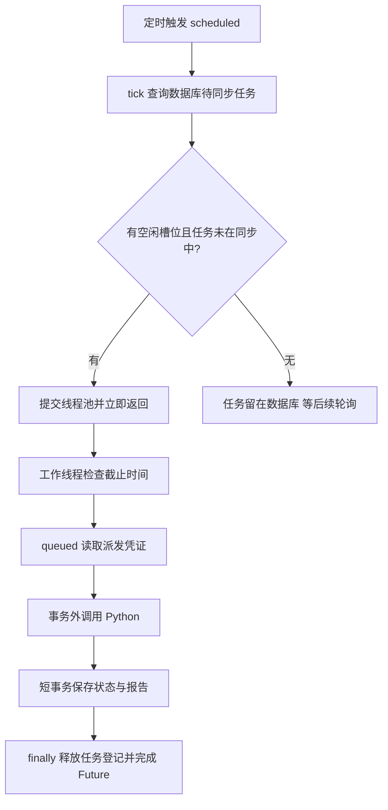

# 任务调度可靠性：从串行轮询到有限并发

本轮从 Java 与 Python 的交界处学习并发：Java 定时查询需要同步的任务，用 HTTP 向 Python 提交或查询，再把结果写回业务数据库。耗时的 Agent 推理发生在 Python 后台，Java 的同步线程只等待这次 HTTP 响应。

## 先理解这次改变解决什么

原来的 `ResearchSynchronizer.tick()` 在一个循环里逐个处理任务。假设任务 A 的查询很慢，后面的任务 B 即使在 Python 中已经完成，也必须等 A 的 HTTP 调用返回后才能同步报告。

现在默认最多有 4 个同步工作单元同时执行。A 阻塞时，B 可以通过另一个槽位查询并保存结果。若 4 个请求全部阻塞，其他任务仍要等待；并发改善慢请求对其他任务的影响，并不消除外部服务的等待时间。



图中的“queued 读取派发凭证”仅对待提交任务执行；running 任务直接查询远端状态。已经截止的任务直接落库为 interrupted，不发送 HTTP。

## 按调用链读代码

1. `ResearchSynchronizer.scheduled()`：保留原有定时轮询，默认每次间隔 2 秒。它调用 `tick()` 后返回，不等待当前 HTTP 批次结束。配置 `scheduling-enabled=false` 时不自动查询数据库。
2. `ResearchSynchronizer.tick()`：调用 `ResearchTaskStore.pending()`，每批最多读取 50 条。检查容量并登记任务 ID，然后提交线程池。该入口用 `synchronized` 保护“检查容量 → 登记 → 提交”这组动作，以及它与关闭动作的关系。
3. `ResearchSynchronizer.synchronize()`：每个任务独立检查截止时间，按状态解析凭证，调用 `WorkerClient.exchange()`。queued 使用 POST，running 使用 GET。
4. `ResearchTaskStoreImpl.apply()` / `problem()`：通过 Spring 管理的服务代理进入短事务，保存状态、报告或同步故障。HTTP 调用发生在这些事务之外。
5. 工作单元的 `finally`：删除正在同步的任务 ID，再完成本次 Future。通信异常、凭证异常、落库运行时异常也必须经过这里。

注意区分 `synchronized` 关键字与名为 `synchronize` 的普通方法：前者在这里串行保护短暂的调度入口，后者运行在工作线程中，没有持有这个调度锁。

## 线程池、去重集合、Future 各做什么

| 组件 | 本项目中的职责 | 需要注意的边界 |
| --- | --- | --- |
| 固定大小线程池 | 最多同时执行配置数量的同步工作 | 不是 Python Agent 推理并发限制 |
| `SynchronousQueue` | 直接交给可用线程，不积压待执行工作 | 没有空闲线程时可能拒绝本次提交 |
| `ConcurrentHashMap.newKeySet()` | 登记本实例正在同步的任务 ID | 只在当前 JVM 有效 |
| `synchronized tick()` | 原子保护检查、登记和提交 | 工作线程的集合删除也需要线程安全 |
| `CompletableFuture<Void>` | 表示这一轮成功接纳的工作已退出 | 不代表业务任务成功或所有待处理任务已处理 |

容量已满的任务没有被删除，也不会因此变成 failed。它仍在数据库里，由后续轮询读取。即使任务集合刚释放了一个槽位，线程池中的线程也可能还在完成收尾，暂时不能接受直接交接；拒绝分支会撤销任务登记，留待后续轮询，不在调度线程执行 HTTP。

`tick()` 返回的 Future 可以让测试精确等待这一批更新完成。生产定时器不等待它；接口返回给用户的业务任务状态仍以数据库为准。一次 tick 可能只接纳部分待处理记录，甚至没有接纳任何记录。

## 为什么仍需要幂等与乐观锁

任务 ID 集合解决的是“一个 Java 实例里，同一个任务正在同步时又被派发”的问题。重启会清空这个集合，多个 Java 实例也各有各的集合。

例如 Java 发出 POST 后超时，Python 可能早已接受并执行任务。Java 后续必须使用同一 task ID 重试，让 Python 的持久化幂等账本识别原执行，不能因为超时就生成新 ID。

Java 的数据库乐观锁和终态保护继续生效，避免更新冲突或把已结束任务重新改为活动状态。它们与进程内去重、Python 幂等账本分别保护不同边界，不能相互替代。本轮仍面向单 Java 调度实例，不保证模型在任意故障下恰好调用一次。

## 为什么删除凭证后要先查询

queued 状态说明 Java 尚未成功保存远端接受结果，不一定说明远端没有收到任务。如果用户此时删除个人 API Key，凭证解析会失败。

项目保留原来的恢复路径：先用相同 ID 发 GET 查询；远端已有执行则继续同步，远端返回执行不存在才记录缺少凭证。这个查询只使用内部服务 Token，不需要重新把个人 API Key 发给 Python。

## 服务关闭时发生什么

Spring 销毁同步器时调用 `@PreDestroy close()`：先取得调度入口锁并停止接纳，再中断工作线程，之后最多等待 10 秒退出。已有 `WorkerClient` 在收到中断时取消 HTTP 等待，工作线程保留中断标记，最后释放任务登记。10 秒是线程池停止后的等待上限；若 `tick()` 的数据库查询卡住，关闭动作取得入口锁前还可能额外等待。

中断本地 HTTP 等待不意味着 Python 停止 Agent，也不把数据库任务自动标成失败。下次启动重新读取数据库中的 queued/running 任务，并继续用同一 ID 查询或派发。线程响应中断需要其调用的代码配合；关闭等待期限到了仍未退出时会记录安全提示。

## 如何配置与验证

默认并发为 4，允许 1～16，错误范围会导致 Java 启动失败并明确提示 `sync-concurrency`。只希望单路同步时可设为 1。配置作用于启动 Java 的进程；IDEA 启动时在运行配置中填写，不会读取其他终端后来设置的环境变量。

```powershell
# 在启动 Java 的同一 PowerShell 中设置
$env:PAPERFLOW_WORKER_SYNC_CONCURRENCY = '4'
cd java-backend
.\run-local.cmd
```

提高这个值会增加同时访问 Python 与数据库的压力。它不会自动增加 Python 推理能力，也不是每用户的模型调用配额。

新增 `ResearchSynchronizerTest` 用闩锁主动控制请求何时阻塞或释放，测试慢请求隔离、并发上限、重复轮询、异常后释放、任务过期、关闭中断、关闭后不再接纳和配置范围。`PersonalDispatchTest` 保留凭证删除后的恢复测试；`ResearchApiTest` 通过真实本地 HTTP 接口和测试数据库回归完整契约。

```powershell
# java-backend 目录，需要 JDK 21～25
.\mvnw.cmd '-Dtest=ResearchSynchronizerTest,PersonalDispatchTest,ResearchApiTest,WorkerClientTest' test
.\mvnw.cmd test package
```

测试中的“这批同步已退出”与“Agent 已经完成研究”是两种不同断言。学习时可先从 slowRequestDoesNotBlockAnotherTask 看闩锁与并发，再读通信失败后用同一 ID 重试，最后阅读关闭测试。

2026-10-24 验证：先用测试复现原串行阻塞，再完成实现。最终 Java 测试共发现 92 项，86 项通过、6 项因未配置专用 Redis 测试端口而跳过，无失败或错误，打包成功；其中新增调度测试 10 项，包含并发设为 1 时的交接拒绝与后续恢复。独立代码评审未发现重要问题。详细输出保存在 `verification-logs/scheduling-final.log`。这些测试不调用真实模型，也没有重启日常服务。
